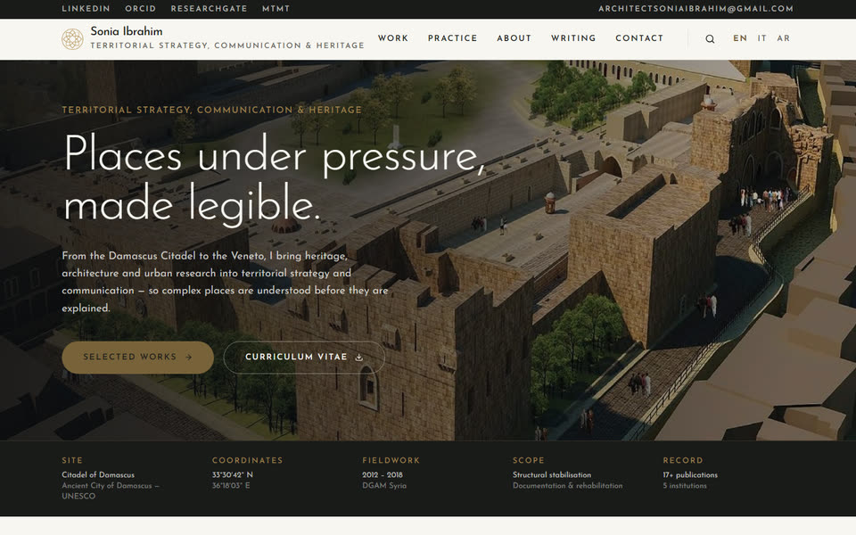
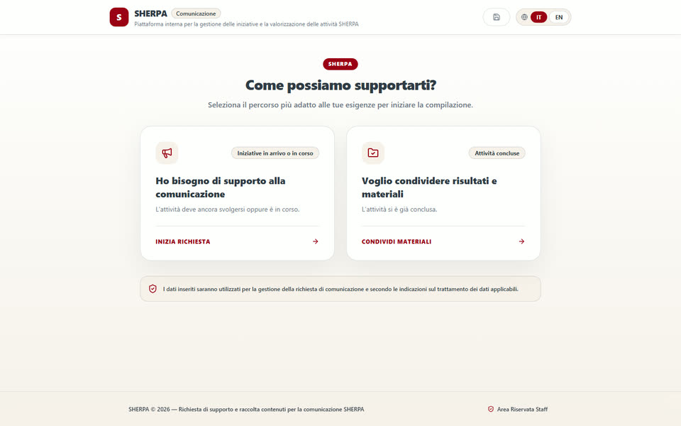
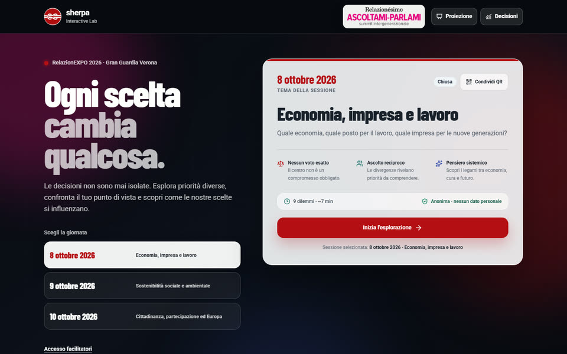
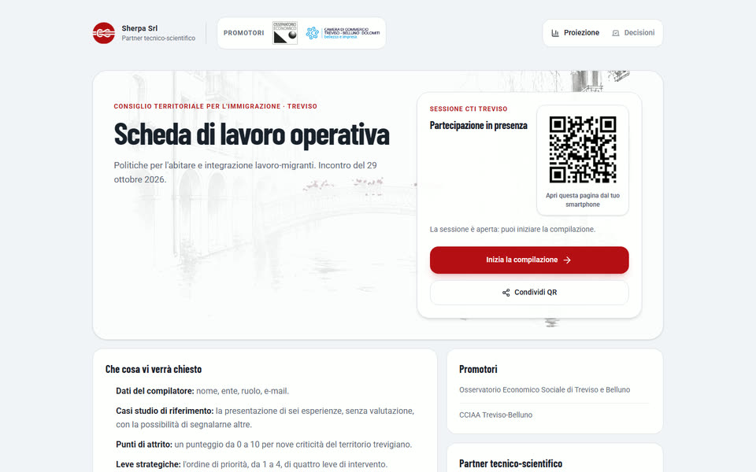
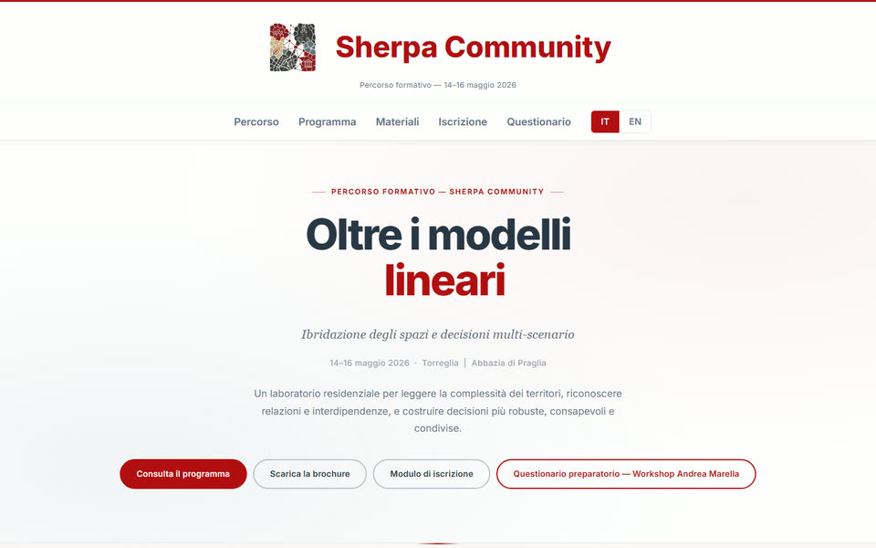
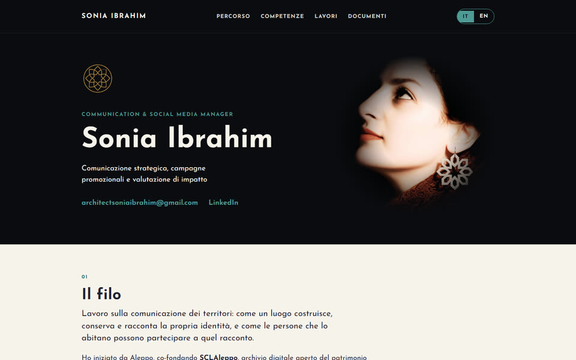
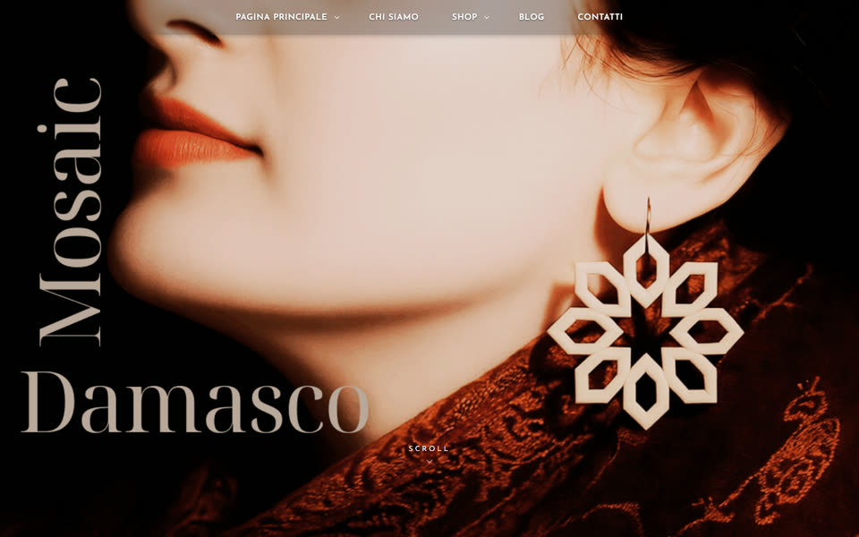
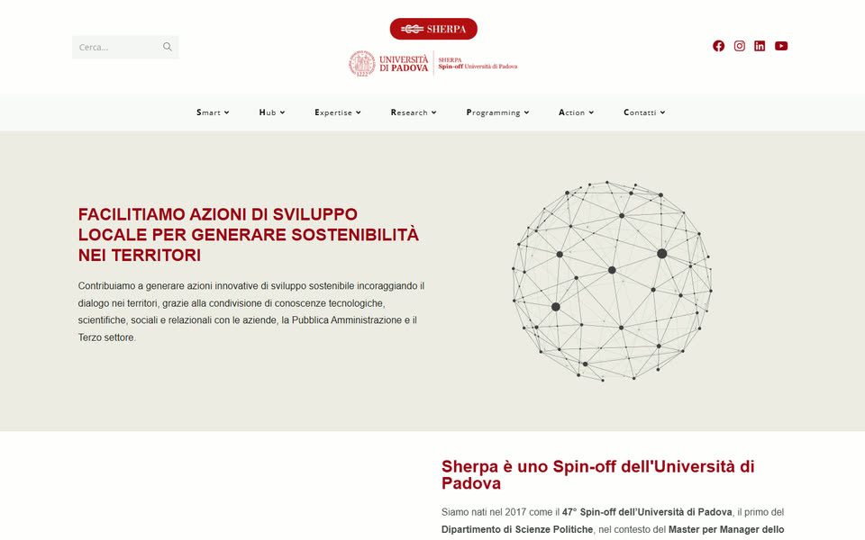

# Sonia Ibrahim

**Architect · Territorial strategy, communication & heritage · Web design and development**

I design and build websites and web tools for places, institutions and projects: portfolios, event platforms, participatory apps and content-intake systems. I work in English, Italian and Arabic.

**Open for freelance work.** Write to [architectsoniaibrahim@gmail.com](mailto:architectsoniaibrahim@gmail.com?subject=Website%20project) · [LinkedIn](https://www.linkedin.com/in/sonia-ibrahim/) · [All projects](https://soniaarchitect.github.io/)

---

## Websites I have built and manage

<table>
  <tr>
    <td width="50%" valign="top">
      
      <h3><a href="https://www.soniaibrahim.it/">soniaibrahim.it</a></h3>
      
My professional site for territorial strategy, communication and heritage. Trilingual (EN · IT · AR), with content edited from a database rather than in code.

      
TypeScript · SQLite · self-hosted on a VPS

    </td>
    <td width="50%" valign="top">
      
      <h3><a href="https://comunicazione.ecosistemasherpasrl.it/">Sherpa Communication Hub</a></h3>
      
An AI-assisted intake platform where a team and its network propose content and request communication support. Two guided paths, photo uploads and a staff area.

      
Web app · AI-assisted forms · IT / EN · for Sherpa SRL

    </td>
  </tr>
  <tr>
    <td width="50%" valign="top">
      
      <h3><a href="https://ascoltami-parlami.ecosistemasherpasrl.it/">Ascoltami–Parlami Interactive Lab</a></h3>
      
A participatory app for RelazionEXPO 2026 in Verona. Students answer from their phones via QR code, while a facilitator console and a live projection show the shared result.

      
Real-time web app · PostgreSQL · Docker · for Sherpa SRL

    </td>
    <td width="50%" valign="top">
      
      <h3><a href="https://cti-treviso.ecosistemasherpasrl.it/">CTI Treviso · Working sheet</a></h3>
      
A participatory working sheet for the Territorial Council for Immigration of Treviso. Participants join by QR code, score local friction points and rank strategic levers, with projection and decision views for the room.

      
Participatory web app · QR sessions · for Sherpa SRL

    </td>
  </tr>
  <tr>
    <td width="50%" valign="top">
      
      <h3><a href="https://communitysherpa.it/sherpa-ecosistema-live-word-cloud">Sherpa Community · Oltre i modelli lineari</a></h3>
      
The site for a three-day residential training programme: programme, materials, registration and a preparatory questionnaire, in Italian and English.

      
React · Vite · TypeScript · Tailwind · for Sherpa SRL

    </td>
    <td width="50%" valign="top">
      
      <h3><a href="https://ciofs.soniaibrahim.it/">Communication portfolio</a></h3>
      
A bilingual portfolio and final report for a professional qualification in communication and promotional campaigns.

      
IT / EN · static site · self-hosted

    </td>
  </tr>
  <tr>
    <td width="50%" valign="top">
      
      <h3><a href="https://mosaicdamasco.altervista.org/">Mosaic Damasco</a></h3>
      
A brand site and shop for jewellery inspired by the mosaics of Damascus.

      
WordPress · brand identity · shop · blog

    </td>
    <td width="50%" valign="top">
      
      <h3><a href="https://www.sherpasrl.it/">sherpasrl.it</a></h3>
      
The website of Sherpa SRL, a University of Padova spin-off. I manage the site: content, pages and custom HTML sections built into the Elementor layouts.

      
WordPress · Elementor · site management · for Sherpa SRL

    </td>
  </tr>
</table>

---

Client projects are shown with their live sites and screenshots. Their source code stays private.
